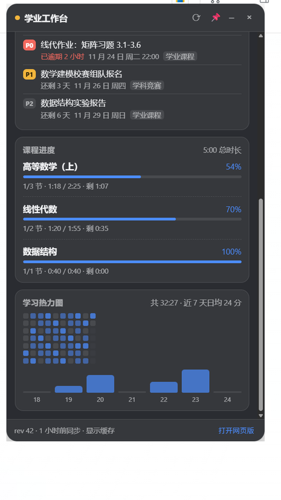
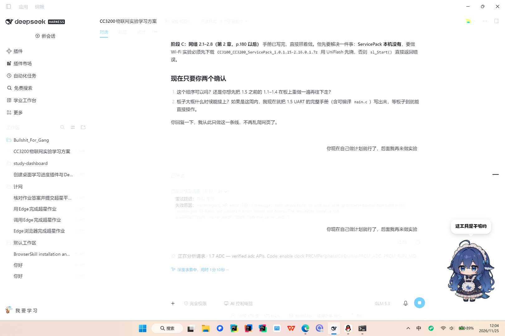
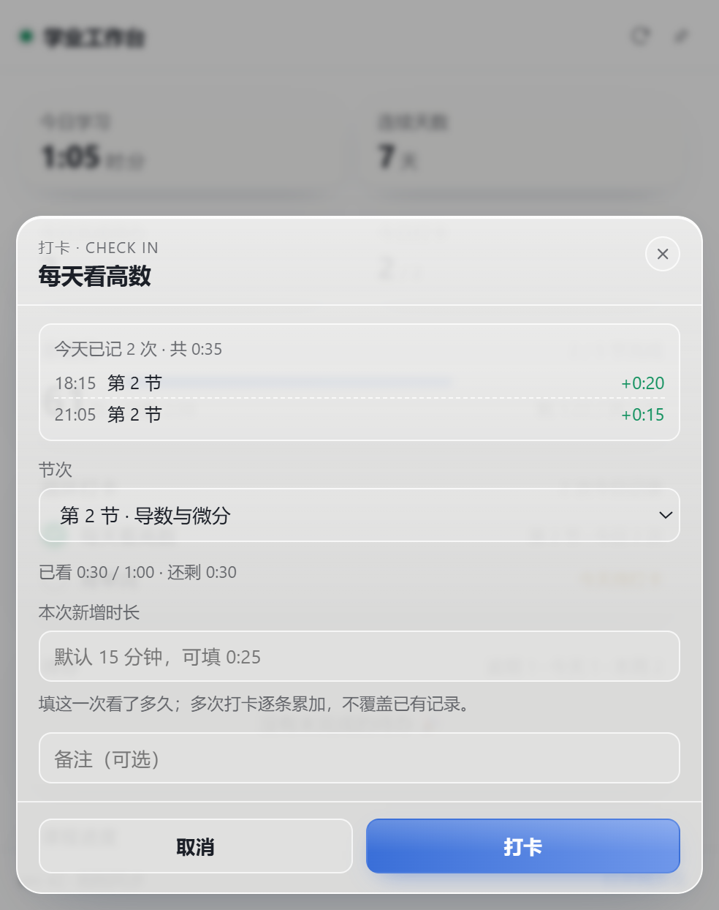

# 学业工作台 · 桌面小组件插件（DSH）

[study-dashboard](../index.html) 的第三个端：把「今天学了多久、课程进度到哪、接下来该做什么」做成一个
**常驻桌面小窗**，同时也能在 DSH 里以**左栏主面板**、侧栏面板、助手工具、斜杠命令四种方式打开。

| 入口 | 位置 | 说明 |
| --- | --- | --- |
| **左栏主面板** | DSH 左侧栏「学业工作台」图标行 → 主区整页 | **本轮新增，配置以它为准**：面板内既能看数据，也能改全部设置 |
| 桌面小窗 | 屏幕右上角（记住上次位置） | 无边框、可拖动、置顶、不占任务栏 |
| 侧栏面板 | DSH 右侧栏「学习进度」 | 与左栏面板、桌面小窗共用同一套页面与设置 |
| Agent 工具 | 任意对话 | `study_widget_progress`，`detail: summary \| full` |
| 斜杠命令 | 输入框 | `/study` 开窗，`/study status` 打印一句进度 |



展示内容与网页版同源同口径：今日学习时长 / 连续天数 / 今日待办完成数 / 今日打卡数、总进度（已看、剩余、完成节数）、
逐课程进度条、逾期·今日·本周待办（优先级 + 剩余时间）、循环打卡周期状态、近 10 周热力图 + 近 7 天柱状图。

**可直接写回云端的两件事**：勾掉待办、按节次打卡（一天可多次）。其余数据仍在网页版/小程序里改。

---

## 1. 安装

插件以本地 link 依赖方式挂在 `desktop` profile 上（仓库内路径，改动即时生效）：

```bash
# 在 DSH 里执行（等价于 plugin_manager install_bundle）
dsh plugin --profile desktop add D:/Users/22608/Desktop/CODE/study-dashboard/plugins/study-widget
```

安装后 profile 的 `package.json` 会多出：

```json
"dependencies": { "@local/dsh-study-widget": "link:D:/Users/22608/Desktop/CODE/study-dashboard/plugins/study-widget" },
"dsh": { "profile": { "bundles": [ "...", "@local/dsh-study-widget" ] } }
```

插件自带的 `cordis.patch.yml` 负责把它插入 loader，无需改 profile 的 patch 层。

## 2. 首次配置（推荐：在 DSH 左栏里配置）

装好即用，**不需要再手写任何文件**。全部配置都在 DSH 内部完成：

1. 打开 DSH，左侧栏点 **「学业工作台」** 图标行，主区出现完整面板。
2. 面板顶栏有 **「进度 | 设置」** 分段控件：点 **「设置」** 在同一 iframe 内切到设置页（`/dsh-study-widget/settings`），点 **「进度」** 切回数据页。切到设置页时顶栏标题变为「设置」，「桌面小窗」按钮隐藏、「刷新」保留。
3. 在 **连接** 分区填 Supabase URL / anon key / 登录邮箱 / 密码 → 先点 **「测试连接」** 看返回 → 再点 **「保存」**。
4. 保存后面板自动拉一次数据，顶部状态条显示数据源、邮箱与最近同步时间；密码只保存一次，之后靠 refresh token 续期。

设置页左侧是分区导航，右侧是表单；每个分区**只提交本分区里有改动的字段**，没改就提示「没有改动，无需保存」。
保存时先在前端校验（URL 格式、数值范围、必填项），不过关的字段会被聚焦并在 toast 里报出字段名。

### 设置页截图



（截图约定：左侧栏「学业工作台」为选中态、主区为面板整页、设置页连接分区可见且密码只显示掩码「已保存」、顶部状态条四格有值；截图中不使用真实 anon key / 邮箱 / 密码。）

### 2.1 连接

| 字段 | 含义 | 生效时机 |
| --- | --- | --- |
| `Supabase URL` | 项目地址，形如 `https://xxxx.supabase.co`（控制台 → Project Settings → API → Project URL） | 保存后立即；必须以 `http://` / `https://` 开头，末尾斜杠会被自动去掉 |
| `anon key（公开密钥）` | 同页面的 anon public key；**只做只读查询，不要填 service_role** | 保存后立即；非空时长度必须 > 20 |
| `登录邮箱` | 与网页端登录同一个账号 | 保存后立即；必须含 `@` |
| `密码` | 账号密码；**只进不出**，已保存时输入框显示「已保存（留空则不改）」 | 保存时才写盘；输入框留空 = 保持原密码不变 |

两个动作：

- **测试连接**：只校验、不落盘。会实际请求 Supabase Auth 与一行 `study_state`，结果分行显示（认证是否通过、拿到几个课程/待办、rev 与更新于）；失败时把 `error.code` 与中文原因原样显示 —— 用来分清是凭据错、账号下没数据还是网络不通。
  失败的 `code` 有：`NO_CREDENTIALS`（四项没填全，消息会直接告诉你「去『学业工作台 → 设置 → 连接』填写」）、
  `AUTH_FAILED`（邮箱或密码不对）、`REFRESH_FAILED`（refresh token 过期）、`REST_FAILED`（读数据被拒）、
  `EMPTY_REMOTE`（认证成功但云端没有数据）、`NETWORK` / `TIMEOUT`。
- **保存**：写 `settings.json` 并**立即**让面板重新拉一次数据。失败时整份文件保持上一次的合法内容（原子写），不会写一半。

**凭据来源优先级**（搞不清「为什么还用着旧密码」时看这里）：

1. `settings.json` 的 `supabase` 分区有 `url` + `anonKey` → 用它（来源标记 `settings`）；
2. 否则读 `login.json`（来源标记 `login`；refresh token 回写 `login.json`）；
3. 两处都没有 → `NO_CREDENTIALS`，消息里写明去哪儿填。

首次读设置时，若 `settings.json` 还没有 `supabase`，会把 `login.json` 的 `url` / `anonKey` / `email` **迁移进视图**
（不删 `login.json`）。注意这种「迁移来的」凭据内部仍标记为来源 `login`，refresh token 也回写 `login.json` ——
所以从旧版本升上来的用户，第一次在设置页保存真实密码之前，凭据仍算「来自 login.json」的那一份。

校验规则（不合规会被拒且**不落盘**）：

| 字段 | 规则 | 错误码 |
| --- | --- | --- |
| `url` | 必须以 `http://` 或 `https://` 开头 | `INVALID_URL` |
| `anonKey` | 非空时长度 > 20 | `INVALID_ANON_KEY` |
| `email` | 必须含 `@` | `INVALID_EMAIL` |
| `password` | 留空 = 不改 | — |
| `desktop.width` | 300–1600 | `OUT_OF_RANGE` |
| `desktop.height` | 320–1600 | `OUT_OF_RANGE` |
| `refresh.summaryTtlSeconds` | 0–3600 | `OUT_OF_RANGE` |
| `refresh.pageSeconds` | 10–86400 | `OUT_OF_RANGE` |
| `data.stateFile` | 必须是绝对路径 | `INVALID_PATH` |
| 布尔字段 | 只能 `true` / `false` | `INVALID_FIELD` |

`settings.json` 本身损坏时，读设置返回 `BAD_SETTINGS_FILE`（不会静默重置成默认值 —— 刻意如此，避免把你配好的东西冲掉）。

> **首次启动会自动迁移**：`settings.json` 不存在时，会把 `login.json` 里的 `url` / `anonKey` / `email` 并进设置（只读迁移，**不删** `login.json`）。
> 所以从旧版本升上来的人不用重新填一遍。详见上面的「凭据来源优先级」。

### 2.2 窗口

| 字段（界面文案） | 键 | 默认 | 说明 | 生效时机 |
| --- | --- | --- | --- | --- |
| 随 DSH 启动自动打开小窗 | `desktop.autoOpen` | 关 | DSH 启动后自动拉起小窗（读的就是这一项，插件静态配置只在它缺失时兜底） | 下次打开 DSH |
| 窗口置顶 | `desktop.alwaysOnTop` | 开 | 小窗是否压在最前 | 下次打开小窗（分区内另有只读「置顶：是/否」显示当前真实状态） |
| 窗口宽度（像素） | `desktop.width` | 380 | 最小 300，过窄会挤坏排版 | 下次打开小窗 |
| 窗口高度（像素） | `desktop.height` | 640 | 最小 320 | 下次打开小窗 |

分区内还有只读的「当前状态 / 当前位置 / 置顶」，读的是小窗进程真实值，不是表单草稿。
**已打开的窗口不会即时变形**——改了尺寸/置顶后保存，卡片下方会提示「下次打开小窗生效」。

开关小窗本身不在这个分区：用面板顶栏按钮、右键菜单、`/study` 命令，或 `POST /api/desktop`。

### 2.3 数据与刷新

| 字段（界面文案） | 键 | 默认 | 说明 | 生效时机 |
| --- | --- | --- | --- | --- |
| 自动刷新 | `refresh.autoRefresh` | 开 | 关掉后页面不再自动拉，只能手点 ↻ | 保存后立即 |
| 页面刷新间隔（秒） | `refresh.pageSeconds` | 300 | 面板/小窗多久自动刷新一次，最小 10 | 保存后立即 |
| 数据缓存时长（秒） | `refresh.summaryTtlSeconds` | 30 | **服务端**同一份快照缓存多久；0 = 每次都读云端 | 保存后立即 |
| 离线模式 | `data.offline` | 关 | 只读 `latest.json` 快照，**完全不打网络**；数据标记为 stale，`status.error` 会说明「离线模式」 | 保存后立即 |
| 本地数据文件（stateFile） | `data.stateFile` | 空 | 填一份导出 JSON 的**绝对路径**，直接把它当数据源（来源标记 `file`）；留空用默认快照 | 保存后立即 |

前两个别混：一个是「**后端**缓存活多久」，一个是「**前端**多久问一次」。
`stateFile` 与 `offline` 都真正生效：前者把该文件当数据源（`source: "file"`，必须是**绝对路径**，相对路径返回 `INVALID_PATH`；空串 = 不指定），
后者只读 `latest.json`、不发起任何请求。

分区下方还有一张只读的「数据目录」卡片（真实路径，排查「设置写哪去了」时看这里）。

### 2.3b 外观（浅色 / 深色 / 液态玻璃）

设置页「外观」分区只有一个开关，作用于**三端**：桌面小窗、DSH 左栏面板、设置页本身。

| 选项 | 小窗外壳 | 页面玻璃 | 什么时候用 |
| --- | --- | --- | --- |
| 跟随系统（默认） | Windows 11 用系统原生亚克力，系统切深浅色时跟着变 | 读 `prefers-color-scheme` | 大多数人 |
| 深色 | 强制深色（关掉原生材质，由页面自己画玻璃） | 深色玻璃 | 系统是浅色但想要深色小窗 |
| 浅色 | 强制浅色 | 浅色玻璃 | 白天 / 打印风格 |

落盘位置是 `settings.json` 的 `appearance.theme`（`system` / `dark` / `light`，其它值 400 `INVALID_FIELD`）。
改完保存后，**新打开的小窗**立刻用新主题；已开着的小窗要重开一次才换壳（页面里的玻璃是立刻预览的）。
在 DSH 面板里切 DSH 自己的深浅色时，面板与设置页会跟着宿主走（宿主 `body[data-ds-dark-theme]`），不受这个开关影响。

**液态玻璃材质是怎么实现的**（三端共用一份配方，改材质只改 `assets/liquid-glass.css`）：

1. **三层合成**：斜高光（118° 白光渐变）+ 半透明填充 + 亮顶边/暗底边（`inset 0 1px 0` + `inset 0 -1px 0`）。
2. **blur 只给真正需要透底的面**：小窗本体 28px、顶栏/底栏 22px、设置页顶栏 22px、吐司 18px。
   卡片、输入框、进度条这些静态面**一律不加** `backdrop-filter` —— 小窗是常驻置顶窗口，静态面加 blur 只会白烧 GPU。
3. **环境光**：小窗没有壁纸可透，`.app::before` 自己铺三块低饱和光斑（浅色是暖朱红+钢蓝+赭黄，深色是冷蓝+青+暖橙），玻璃才有东西可「透」。
4. **降级**：`prefers-reduced-transparency: reduce` 时所有玻璃回退成实心底并关掉 blur；`prefers-reduced-motion` 时只留透明度过渡；不支持 `backdrop-filter` 的环境用更实的填充色顶上。
5. **圆角**：Windows 11 的无边框窗口本身是直角，页面用 `border-radius: 16px` + 透明 Electron 窗口把四角切出来，所以小窗看起来是一整块圆角玻璃。

改材质后的自检：`python scripts/build-css.py --write`（拼装 + 检查），`python scripts/check-css.py`（扫注释嵌套与花括号配对）。
### 2.4 插件

| 动作 | 说明 | 生效时机 |
| --- | --- | --- |
| 启用 / 禁用 | 禁用后左栏入口、数据接口与桌面小窗都停止；数据目录里的设置**保留** | 宿主热重载（几秒） |
| 重载 | 等于「先禁用再启用」——宿主只提供这两个动作，用来让改过的插件代码重新挂载 | 立即 |

卡片顶部显示插件当前状态（已启用 / 已禁用 / 未知）、入口 id 与阶段。

开关走的是 **宿主插件管理服务的委托**：插件只把 `启用/禁用` 交给宿主 `pluginManager`
（`setPluginEnabled` / `setBundleEnabled`），由宿主自己去改 profile 的 patch 并重载 ——
插件代码不碰 `cordis.patch.yml`，也不碰 `package.json`。所以「禁用再启用」不会丢凭据，也不会把 profile 写坏。

**结果以返回的 `applied` 为准，运行中开关可能失败。** enable/disable 只委托 `setPluginEnabled(include:dsh-study-widget)`，
**不会**自动 fallback 到 `setBundleEnabled`。宿主对「由 bundle 加载的插件」通常在运行中判为不可寻址，此时返回
`applied: "failed"`，消息会写明「当前宿主不允许在运行中开关由 bundle 加载的插件（…）。请到 DSH『设置 → 插件』里操作，或重启 DSH 后生效」，
并附上宿主原文。`restart` 若在禁用阶段就失败，返回 `partial: true` + 「已尝试禁用但失败，插件仍在运行」。

> **已知限制**：宿主 `setPluginEnabled` 对 profile patch 里 `include` 行加载的插件判定为 `unaddressable`
> （DSH 源码 `packages/boot/plugin-manager/src/index.ts` 483–489 行）。这是 **DSH 自身行为，不是本插件 bug**。
> 遇到时请改到 DSH 的插件管理里操作，或重启 DSH。

拿不到该服务时接口返回 `ok:false` + `code: "NO_PLUGIN_MANAGER"`；
`packageName` 字段固定返回 `@local/dsh-study-widget`。

### 2.5 高级

| 区块 | 内容 | 生效时机 |
| --- | --- | --- |
| **运行环境** | `Electron 可执行文件路径`（留空自动探测，填绝对路径；直接开小窗时用 `DSH_STUDY_WIDGET_ELECTRON` 覆盖），以及只读的「数据目录」「settings.json」「login.json」三个路径 | 下次打开小窗 |
| **数据快照** | 「导出快照」把当前数据写成 JSON（自动下载，同时在文本框里显示）；「导入快照」把文本框里的网页版备份 / `latest.json` 写成本地快照（只影响本地缓存，不动云端） | 点击即生效 |

`settingsFile` / `loginFile` 是**只读字段**（绝对路径，不进 `settings.json`），用来在排查时确认「设置到底写在哪个文件」。

导入支持的格式：`latest.json`、`{data, rev}` 包裹、裸 `state`、网页版备份。导入前会把旧 `latest.json`
备份成 `latest.json.bak`（响应里 `backup` 字段给出路径），出问题可以拿它回滚。

### 2.6 关于

版本、当前数据源（Supabase 云端 / 本地快照 / 本地缓存，离线时标注）、插件入口 id、上次同步（rev + 时间），
以及插件 README / 仓库 / 网页版三个链接。只读，没有可改项。

## 3. 命令行 / 无 UI 时的备用方式

下面这套**仍然可用**，但只用于「没有 DSH 图形界面」「批量部署」「排查问题」等场景。
正常使用请走第 2 节的左栏设置页 —— 手改文件不会经过表单校验，写错不会给提示。

凭据文件位置（与 `settings.json` 同目录）：

```
C:\Users\22608\.dsh\study-widget\login.json
```

```json
{
  "url": "https://xxxx.supabase.co",
  "anonKey": "eyJhbGciOi...（Supabase 控制台 Settings → API 的 anon public key）",
  "email": "你的账号邮箱",
  "password": "你的密码"
}
```

- 密码登录成功后，refresh token 会自动回写同一文件，之后不再需要密码。
- **注意存法**：设置页保存的密码以**明文**存在本机 `~/.dsh/study-widget/settings.json` 的 `secret.password` 里
  （API 永不回传，只给 `hasPassword`）；登录成功后拿到的 refresh token 只在宿主内存里复用，不落盘。
  如果不想让明文密码落在磁盘上，用下面的 `refreshToken` / `passwordCommand` 方式，不要填 `password`。
- 不想存密码：只填 `email`，在网页版登录一次，把 localStorage 里 `study-supabase-session-v1`
  的 `refresh_token` 贴到 login.json 的 `refreshToken` 字段。
- 支持 `passwordCommand`（执行命令取密码），适合用系统钥匙串而不是明文。
- 同目录其它文件：`settings.json`（左栏设置页保存的全部设置）、`latest.json`（最近一次成功快照，
  断网/未配置时用它，页脚标「显示缓存」）、`window.json`（小窗位置）、`state.json`（上一次监听，可选）。
- 换数据目录：环境变量 `DSH_STUDY_WIDGET_HOME`。
- **优先级**：`stateFile`（指定文件）> Supabase（设置页保存的 `settings.json` 凭据，其次 `login.json`）> `latest.json` 缓存。

当前该目录放的是一份**演示数据**（`demo@study.local`），在设置页填好真实凭据并保存后即切换。

## 4. 日常操作

| 操作 | 效果 |
| --- | --- |
| 左栏点「学业工作台」 | 主区打开完整面板（看数据 + 进设置） |
| 按住顶栏拖动 | 移动窗口，松手记住位置 |
| ↻ | 立即刷新 |
| 📌 | 切换置顶 |
| — / × | 隐藏 / 退出 |
| 右键 | 置顶、刷新数据、打开网页版工作台、隐藏、退出 |
| 点任意打卡项 | 弹出打卡弹层：默认当前节次、填本次时长，可一天多次（见 6.1） |

小窗关掉后：`/study` 或侧栏面板顶栏的「📌 桌面小窗」可重新打开。

## 5. 配置项（插件 `apply()` 第二参数）

这些是**插件挂载时**读的静态配置，由 profile 的 patch 层给出，改完要重载插件；
它们与第 2 节设置页里的东西是两套：**能用设置页改的，优先用设置页**。

| 键 | 默认 | 说明 |
| --- | --- | --- |
| `electronPath` | 空 | 自定义 Electron；留空则 `$DSH_HOME/electron/electron.exe`，再不行用 `DSH_STUDY_WIDGET_ELECTRON` |
| `autoOpen` | `false` | 插件加载后自动开窗。**设置页的「随 DSH 启动自动打开小窗」优先**：`settings.json` 的 `desktop.autoOpen` 有布尔值时就以它为准，这里只作兜底 |
| `stateFile` | 空 | 覆盖 `latest.json` 路径 |
| `offline` | `false` | 强制离线，只读缓存 |

数据新鲜度：宿主侧默认 30 秒缓存（`summaryTtlSeconds`，**0 = 每次都读云端**，读设置失败时回落 30 秒），
页面每 5 分钟拉一次（`pageSeconds`）；两者都能在设置页「数据与刷新」分区改，保存即生效。

## 6. HTTP 接口

前缀 `/dsh-study-widget`：

| 路径 | 说明 |
| --- | --- |
| `GET /` | 小组件页面（`?t=<token>`、DSH Cookie 或本机同源可访问） |
| `GET /settings` | 设置页（同样三种鉴权之一） |
| `GET /api/settings` | 全部设置 + 数据源状态 + 小窗 + 插件状态；**不含明文密码**，只有 `hasPassword` |
| `POST /api/settings` | 保存设置（部分字段即可），保存后立即刷一次数据 |
| `POST /api/settings/test` | 只校验不落盘，返回认证与数据两段结果 |
| `GET /api/summary` | 统计数据 JSON，包一层 `{ok, summary, status}`；`?refresh=1` 强制拉取 |
| `POST /api/checkin/log` | 追加一次打卡 `{id, min, cid, lid, note?}`；**一天可多次，每次一条独立记录**，同时累加 `activity`、合并 `details`、推进课时 `watchedMin` |
| `POST /api/checkin/unlog` | 撤销某一条打卡记录 `{id, at}`（只删 log，不回滚已计入的时长） |
| `GET /api/status` | 凭据路径、上次同步、小窗进程状态 |
| `GET /api/desktop` / `POST /api/desktop` | 读取小窗状态 / `open`·`close`·`hide`·`pin` |
| `POST /api/open-desktop` / `POST /api/close-desktop` | 开关小窗（旧接口，保留兼容） |
| `GET/POST /api/bounds` | 读取 / 保存小窗位置 |
| `GET /api/plugin` / `POST /api/plugin` | 插件自身状态 / 委托宿主 `pluginManager` 做 `enable`·`disable`·`restart` |
| `GET /api/sources` / `POST /api/sources/import` / `POST /api/sources/export` | 数据源列表 / 导入 / 导出快照 |

鉴权失败一律 401；静态资源限制在 `assets/` 目录内，越界返回 403/404。

### 6.1 打卡（一天可多次）



小窗、侧栏面板共用同一套打卡交互，与小程序版一致地「弹层 + 填本次时长」，但按课程**节次**记录：

- 点任意打卡项 → 弹出弹层，**默认选中「当前节次」**（该课程第一个有总时长、还没看完的课时）。
- 下拉框可手动切到别的节次；切完进度提示实时刷新（`已看 0:30 / 1:00 · 还剩 0:30`）。
- **本次新增时长**支持 `25`、`0:25`、`1小时5分` 三种写法；留空按占位提示（最多 15 分钟或该节剩余）。
- **一天可以打多次**：每次写一条独立 log（时间 + 节次 + 分钟），弹层顶部逐条列出「今天已记 N 次」。
- 这一节看完后，下次打开弹层自动落到下一节；全部看完显示「全部看完」。

写入同时做三件事，口径与网页版 `app.js` 的 `recordDetail` / `addCheckinLog` 完全一致：

| 写入 | 规则 |
| --- | --- |
| `checkins[].logs` | 追加一条 `{date, at, min, cid, lid, idx, note?}`，**不合并** |
| `activity[today]` | 累加本次分钟数 |
| `details[today]` | 同一课程同一节当天合并累加（网页端「当日明细」就是这个结构） |
| `course.lessons[].watchedMin` | 累加并封顶到 `totalMin`（未填总时长时封顶 9999） |

> 撤销单条（`/api/checkin/unlog`）只删除 log 本身，**不回滚**已计入的 `activity` / `details` / `watchedMin`
> —— 网页端同样不支持反算，贸然回滚会让历史统计与网页端对不上。

## 7. 自测

```bash
node plugins/study-widget/scripts/smoke.mjs           # 15 项断言，不用启动 DSH
node plugins/study-widget/scripts/smoke-settings.mjs  # 设置端点断言（见下）
```

- `smoke.mjs`：用假 ctx 跑 `apply()`，真实监听端口，覆盖页面/样式/脚本/图标、`/api/summary`（缓存回落、
  总进度 75% 1/2、逾期计数、热力图 70 格）、`/api/status`、404 与路径越权。数据目录用临时目录，不碰真实凭据。
- `smoke-settings.mjs`：77 项断言，覆盖 `/api/settings` 的读取与掩码（无明文密码）、保存与回读、
  `/api/settings/test` 的失败语义、`/api/desktop` 的降级（`persisted` / `closed` / `noop`）、
  `/api/plugin` 在拿不到 `pluginManager` 时返回 `NO_PLUGIN_MANAGER`、`/api/sources` 导入导出往返、设置文件原子写。

端到端人工验收清单见 [docs/ACCEPTANCE.md](docs/ACCEPTANCE.md)（含插件加载 → 左栏入口 → 主面板 → 设置 →
填错/填对 URL → 数据刷新 → 窗口与置顶 → 禁用再启用 → 重启持久化 → 卸载不残留，每步都有期望与证据栏）。

## 8. 文件结构

```
plugins/study-widget/
├── index.js            host 半边：路由、/api、设置端点、小窗启动、agent tool、/study 命令
├── client.js           左栏入口 + 主面板页 + 侧栏标签（iframe 承载同一套页面，主题 token 透传）
├── cordis.patch.yml    自动挂载
├── lib/
│   ├── settings.js     设置读写与归一化（settings.json、原子写、密码只进不出）
│   ├── source.js       登录 / refresh / 拉取 / 缓存回落
│   ├── summary.js      把 Supabase 原始 state 归一化成快照
│   ├── stats.js        统计口径（复刻网页版 app.js）+ 节次定位 currentLesson / lessonOptions
│   ├── mutate.js       写入：待办勾选、打卡（一天多次每条独立记录）、撤销单条
│   └── desktop.js      Electron 进程的启动、复用、退出与位置记忆
├── desktop/
│   ├── main.cjs        Electron 主进程（窗口、置顶、右键菜单、单实例、设置页模式）
│   └── preload.cjs     contextBridge 暴露的最小 IPC 面
├── assets/
│   ├── liquid-glass.css        液态玻璃材质（变量 + 三层配方 + 双主题 + 降级），三端共用
│   ├── liquid-glass-settings.css 设置页各组件的玻璃覆盖（顶栏/卡片/输入/按键/开关/分段控件）
│   ├── widget.css      小组件布局（build-css.py 会把材质拼在前面，产物已提交）
│   ├── widget.*        小组件页面（桌面小窗 / 面板两种模式共用样式）
│   └── settings.*      设置页（左侧分区导航 + 右侧表单，七个分区，含「外观」）
├── locale/             中英文案
├── scripts/
│   ├── build-css.py    拼装「材质 + 布局」两份 CSS 并做解析级检查（--write 落盘）
│   ├── check-css.py    扫注释体里嵌注释、裸 {} 块、花括号不配对这类静默丢规则问题
│   ├── smoke.mjs       冒烟自测
│   └── smoke-settings.mjs 设置端点自测
└── docs/
    ├── shots/          界面截图（文档用）
    └── ACCEPTANCE.md   端到端验收清单
```

> `desktop/*.cjs` 必须是 `.cjs`：包是 `"type": "module"`，Electron 主进程要用 CommonJS 的 `require`。

## 9. 常见问题

**左栏没有「学业工作台」？** 插件未启用（设置页/插件管理里打开），或 DSH 版本太旧没有 `sidebar.panellist` 槽；
降级时仍可用右侧栏「学习进度」标签与 `/study` 命令。

**点左栏没反应？** 说明入口 id 与主面板 `main` 的 key 没对上 —— 看 DSH 控制台有无「主面板条目不存在」类报错。

**小窗没出现？** 看 `/api/status` 的 `desktop`：`running=false` 且有 `error` → 按提示检查 Electron 路径（设置页「高级」）；
`execPath` 为空说明没找到 Electron。

**显示「还没有配置」？** 设置页「连接」分区没填完。填好后先「测试连接」，看是认证失败还是没数据。

**保存了但没生效？** 设置页顶部状态条会给失败原因；`/api/settings` 里 `status` 段有凭据来路与上次错误。
「窗口」与「高级」里的项保存后本来就要等下次开窗才生效，卡片下方会明确提示。

**点了打卡没反应 / 弹层没出来？** 打卡弹层是 `assets/widget.js` 里的 `openCheckinSheet`，
只改 `assets/` 的话刷新页面即可；若弹层能开但提交报错，看脚注提示的 `error.code`：
`MIN_REQUIRED`（视频打卡没填时长）、`LESSON_REQUIRED`（没选节次）、`LESSON_NOT_FOUND`（课时已被网页端删掉）、
`READ_ONLY_SOURCE`（当前是本地文件/缓存，不能写云端）。

**数据比网页版旧？** 页脚「rev N · X 前同步」。点 ↻ 强制刷新；或把「数据缓存时长」调小。
Supabase 不可达时继续用 `latest.json` 并标「显示缓存」。

**改了代码？** 只改 `assets/` → 刷新页面即可；改 `lib/`、`index.js`、`client.js` → 设置页「插件 → 重载」（或关掉再启用）；
改 `desktop/*.cjs` → 必须关掉小窗再打开（独立进程不会热更新）。

**忘了密码存在哪？** 设置页保存的密码在 `~/.dsh/study-widget/settings.json` 的 `secret.password`（**明文**，
属于本机私有文件，不要提交进仓库）；refresh token 只在内存中复用，不落盘。`hasPassword: true` 表示「有可用凭据」。
要换账号，在连接分区重新填邮箱与密码保存即可；要彻底清掉本机密码，用 `clearPassword` 或删掉该文件。

**想让它跟着开机启动？** 设置页「窗口 → 随 DSH 启动自动打开小窗」，再把 DSH 本身加入开机启动项。
